# SMM Authority

SaaS that helps prospects build online authority, grow their brand and convert attention into leads.
See [`docs/PRD.md`](docs/PRD.md) and [`docs/SCOPE.md`](docs/SCOPE.md).

> **Deploying?** See [docs/DEPLOY.md](docs/DEPLOY.md) (one VPS, nginx + systemd, HTTPS with certbot, install and update scripts in `deploy/`).

## Layout

| Folder | What | Stack |
|---|---|---|
| [`api/`](api) | Standalone REST API. Owns auth, roles, data. | Python, FastAPI, SQLAlchemy 2 |
| [`dashboard/`](dashboard) | Web UI. Talks to the API over HTTP only, never to the database. | React, TypeScript, Vite |

The two are deployed and versioned independently; the only contract between them is the API
(`/docs` serves interactive OpenAPI docs). Recurring jobs (ingestion, scheduling, metrics) will be
Python scripts living beside the API; AI APIs are used for research only (see PRD section 7).

## Roles and ownership

- **user**: registers themselves, creates **any number of ventures**, sees and edits only their own.
- **admin**: everything a user can do, plus manage users (create, change role, deactivate/reactivate, reset password)
  and view/edit/delete any venture (`GET /ventures?scope=all`).
- Self-registration always creates a `user`. The first admin is bootstrapped from `SMM_ADMIN_EMAIL` /
  `SMM_ADMIN_PASSWORD` at startup (never overwritten if it already exists). Admins can promote others.
- An admin cannot demote or deactivate their own account, so an admin always remains.
- Deactivation takes effect immediately (the user is re-checked on every request).
- A venture belongs to one owner; other users get `404` (not `403`) for ventures they don't own.
  Venture names are unique per owner.

## Run it locally

```bash
./scripts/dev.sh            # first run installs dependencies; add --reset to rebuild the demo data
```

That starts the API on <http://localhost:8000> (interactive docs at `/docs`) and the dashboard on <http://localhost:5173>,
and loads **demo data** (a fictional venture with a brief, a trend feed, an 8-week plan and results) so every screen has
something in it. Sign in as `demo@example.com` / `demo-password-1`, or as the admin `admin@example.com` / `change-me-now`
(from `api/.env`). Needs Python 3.11+ and Node 20+ (developed on Python 3.13 and Node 22).

AI features (setup suggestions, feed scoring, drafting) need `ANTHROPIC_API_KEY` in `api/.env`; without it those buttons
show a clear "not configured" message and the rest of the app works.

Manual setup, if you prefer:

```bash
cd api && python3 -m venv .venv && .venv/bin/pip install -r requirements-dev.txt && cp .env.example .env
.venv/bin/python -m app.demo                                   # optional demo data
.venv/bin/uvicorn --factory app.main:create_app --reload       # API
cd dashboard && cp .env.example .env && npm install && npm run dev   # dashboard
```

Tests: `cd api && .venv/bin/python -m pytest` and `cd dashboard && npm run build` (typecheck + build).

## Screenshots (demo data)

| | |
|---|---|
| 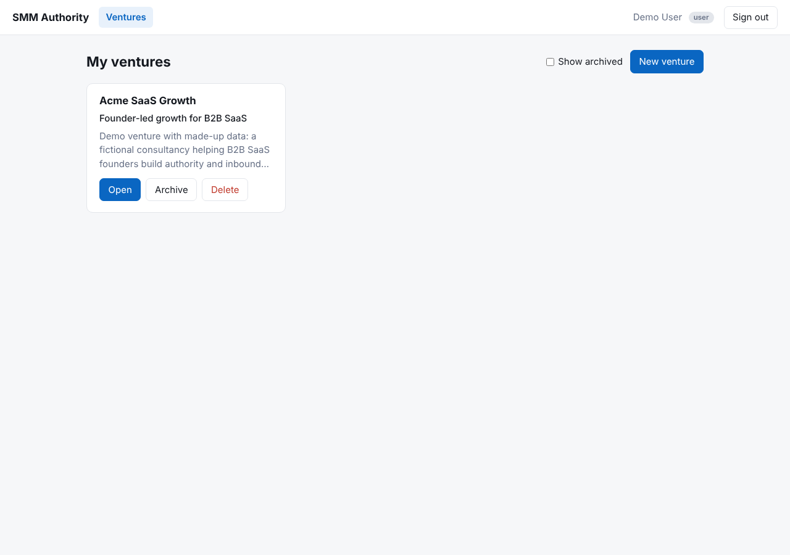 **Ventures** | 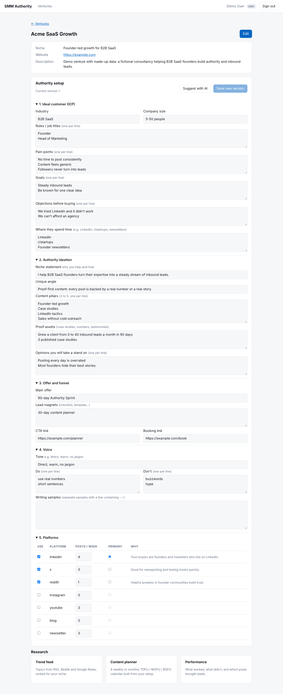 **Authority setup** |
| 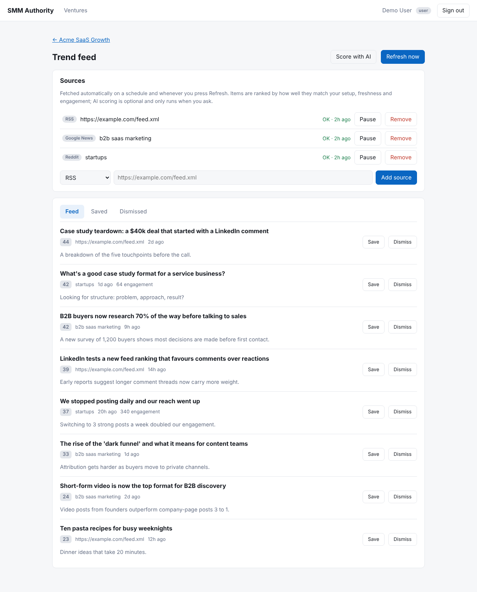 **Trend feed** | 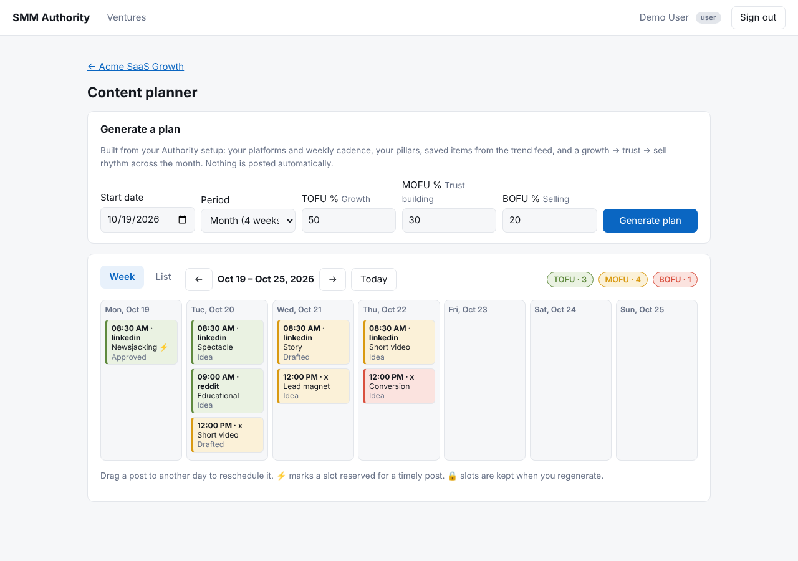 **Content planner** |
| 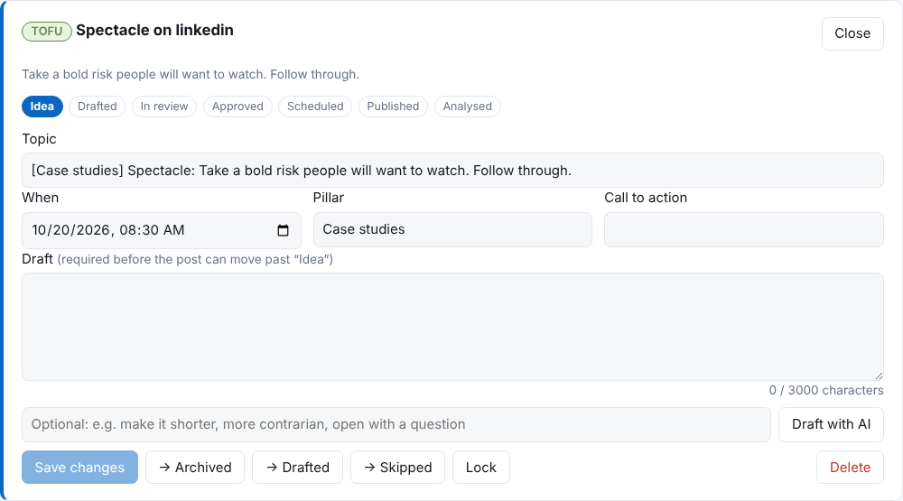 **Post editor and pipeline** | 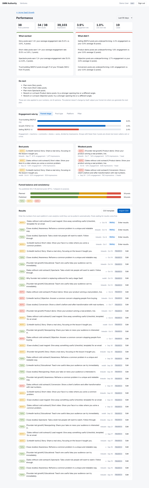 **Performance** |
| 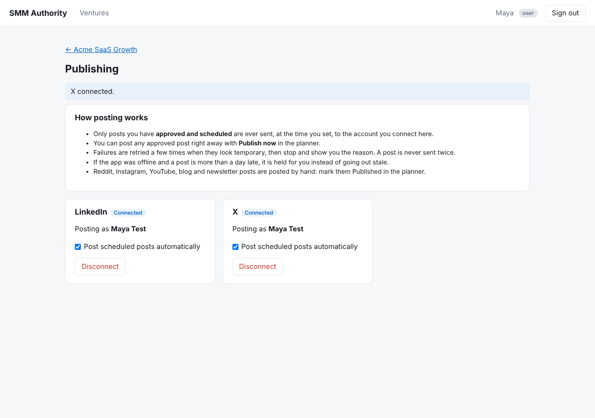 **Publishing: connect accounts** | 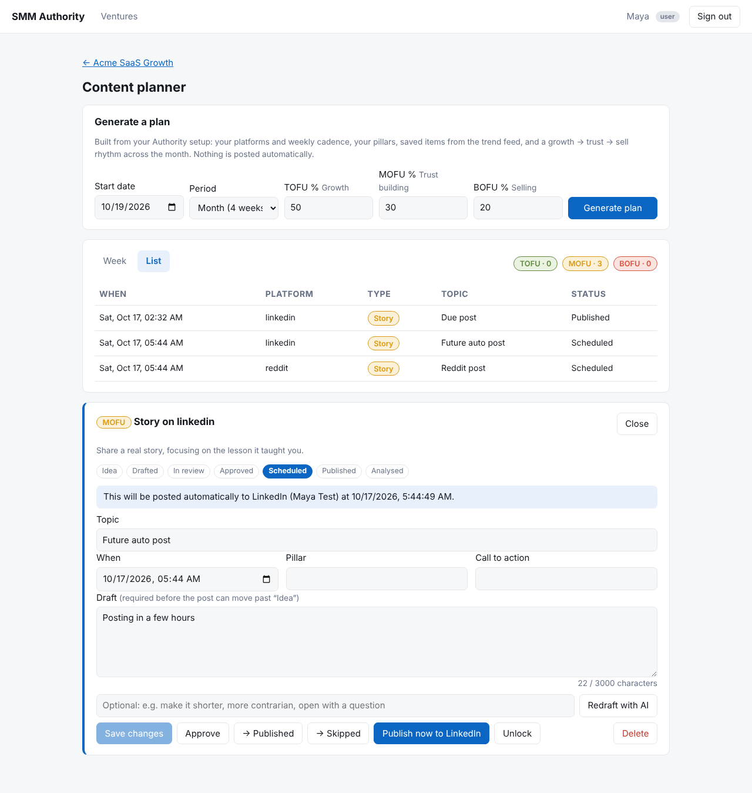 **A scheduled post that will go out automatically** |
| 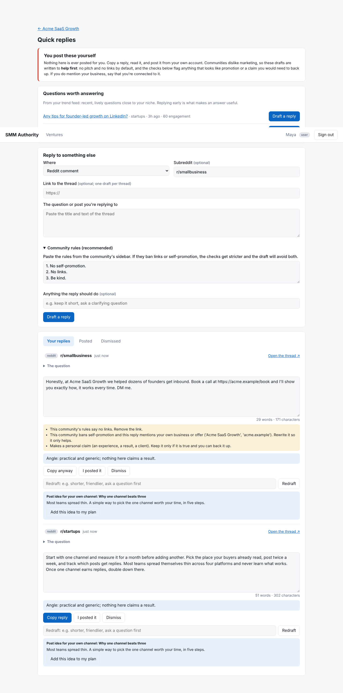 **Quick replies: safeguards flagging a pitchy draft** | 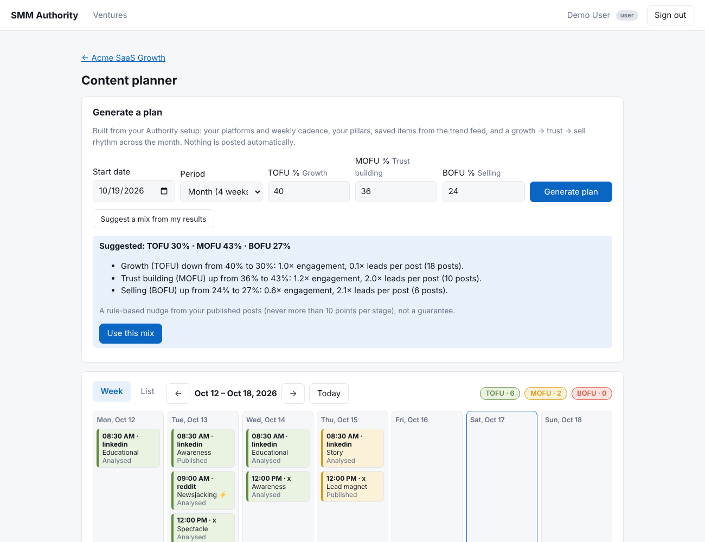 **Planner: funnel mix suggested from results** |
| 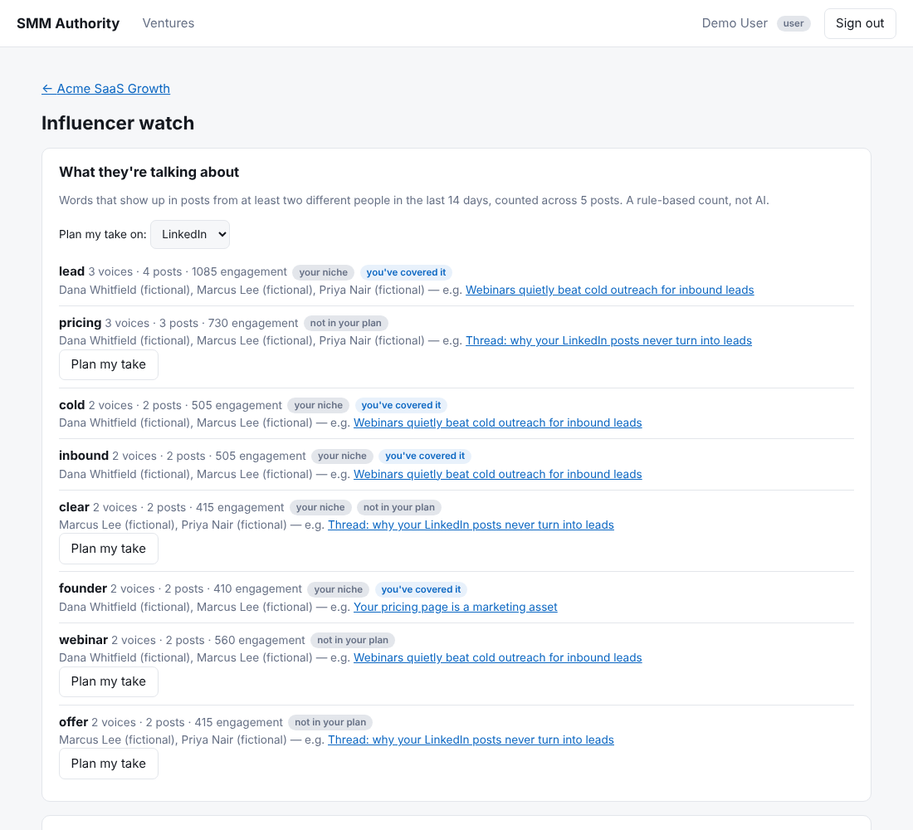 **Influencer watch: topics several voices are discussing** | 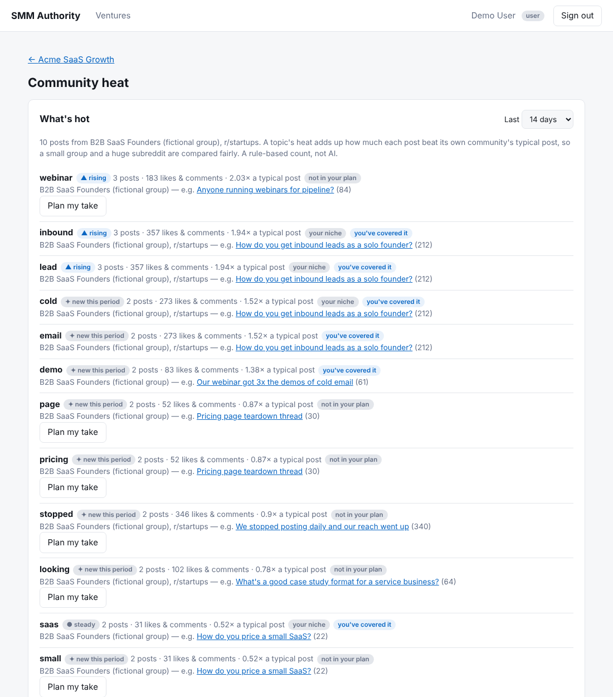 **Community heat: rising and cooling topics** |
| 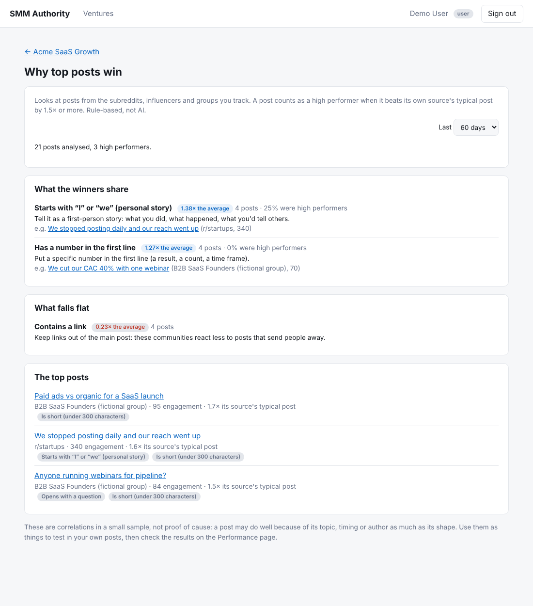 **Why top posts win: shared patterns** | |

## API overview

| Method | Path | Access |
|---|---|---|
| POST | `/auth/register`, `/auth/login` | public |
| GET | `/auth/me` | any signed-in user |
| GET/POST | `/ventures` (`?scope=mine\|all`, `include_archived`, `limit`, `offset`) | user (`all` = admin) |
| GET/PATCH/DELETE | `/ventures/{id}` | owner or admin |
| GET/PUT | `/ventures/{id}/brief` (PUT appends a new version) | owner or admin |
| GET | `/ventures/{id}/brief/versions`, `/ventures/{id}/brief/versions/{n}` | owner or admin |
| POST | `/ventures/{id}/brief/suggest` (AI draft, not saved) | owner or admin |
| GET/POST | `/ventures/{id}/sources`, PATCH/DELETE `/ventures/{id}/sources/{sid}` | owner or admin |
| GET | `/ventures/{id}/feed` (`status=active\|new\|saved\|dismissed`, `source_id`, `limit`, `offset`) | owner or admin |
| PATCH | `/ventures/{id}/feed/{item}` (save / dismiss / restore) | owner or admin |
| POST | `/ventures/{id}/feed/refresh` (runs the ingest script now), `/ventures/{id}/feed/score` (on-demand AI) | owner or admin |
| GET | `/planner/framework` (stages, post types, platform rules, status pipeline) | any signed-in user |
| POST | `/ventures/{id}/plan/generate` (`start_date`, `period=week\|month`, `timezone`, `mix`, `replace`) | owner or admin |
| GET | `/ventures/{id}/plan` (`start`, `end`, `status`, `include_archived`) | owner or admin |
| POST / PATCH / DELETE | `/ventures/{id}/plan/slots[/{slot}]` | owner or admin |
| POST | `/ventures/{id}/plan/slots/{slot}/draft` (AI draft, not saved) | owner or admin |
| GET/POST | `/ventures/{id}/influencers` | owner or admin |
| PATCH/DELETE | `/ventures/{id}/influencers/{id}` | owner or admin |
| POST | `/ventures/{id}/influencers/{id}/posts` (paste a post) | owner or admin |
| GET | `/ventures/{id}/influencers/digest` (`days`) | owner or admin |
| GET/POST | `/ventures/{id}/communities` | owner or admin |
| PATCH/DELETE | `/ventures/{id}/communities/{id}` | owner or admin |
| POST | `/ventures/{id}/communities/{id}/posts` (paste a post: likes + comments) | owner or admin |
| GET | `/ventures/{id}/communities/heat` (`days`) | owner or admin |
| GET | `/ventures/{id}/top-posts` (`days`) | owner or admin |
| GET | `/ventures/{id}/plan/slots/{id}/metrics/auto` (is this post's data automatic, next pull) | owner or admin |
| POST | `/ventures/{id}/plan/slots/{id}/metrics/refresh` (read it from the platform now) | owner or admin |
| GET | `/ventures/{id}/insights` (`days`, optional `tofu`/`mofu`/`bofu` = the mix you plan with) | owner or admin |
| GET / PUT | `/ventures/{id}/plan/slots/{slot}/metrics` | owner or admin |
| POST | `/ventures/{id}/metrics/import` (CSV in JSON body) | owner or admin |
| GET | `/ventures/{id}/integrations`; POST `/ventures/{id}/integrations/{platform}/connect`; PATCH / DELETE `/ventures/{id}/integrations/{platform}` | owner or admin |
| GET | `/integrations/{platform}/callback` (where LinkedIn / X send the browser back; secured by a one-time state) | public |
| POST | `/ventures/{id}/plan/slots/{slot}/publish` (Publish now) | owner or admin |
| GET | `/ventures/{id}/replies/opportunities` (questions worth answering, scripted ranking) | owner or admin |
| POST | `/ventures/{id}/replies/draft` (from a pasted thread or a feed item); POST `.../replies/{id}/redraft`, `.../replies/{id}/to-plan` | owner or admin |
| GET / PATCH / DELETE | `/ventures/{id}/replies[/{id}]` | owner or admin |
| GET/POST | `/users` | admin |
| GET/PATCH | `/users/{id}` | admin |
| GET | `/health` | public |

## Authority setup (per venture)

Each venture has a one-time, editable **Authority Brief**: ICP, ideation (niche, angle, 3-5 pillars, proof, opinions),
offer/funnel links, voice, and platform choice with weekly cadence. Saving never edits history, it appends a new version,
and restoring an old version is just saving it again.

"Suggest with AI" drafts ideation and platform choices from what the user has typed. It is on-demand only, never saved
automatically, and is capped per non-admin user per 24h (`SMM_AI_DAILY_LIMIT_PER_USER`). Calls go through
`app/ai.py` (Anthropic SDK, structured output, model `SMM_AI_MODEL`). Without `ANTHROPIC_API_KEY` the endpoint
returns 503 and the rest of the app is unaffected. Token usage is recorded in `ai_usage`.

## Trend feed

Each venture has sources: **RSS URLs, subreddits, and Google News queries** (up to 20). Items are ranked for the niche
without any AI: the ingest script scores each one 0-100 from keyword overlap with the venture's Authority Brief (50%),
freshness (30%) and engagement (20%). **Score with AI** (optional, on request, counts against the daily AI limit) sends only
the best unscored items from the last 14 days, in one call, and stores a 0-100 relevance and a one-line "why it matters".
Items are deduplicated by normalised URL, can be saved or dismissed (dismissed items do not come back), and unsaved items
are pruned after `SMM_FEED_RETENTION_DAYS` (30).

The recurring work is a plain script, not an AI call. Schedule it, for example hourly:

```cron
0 * * * *  cd /srv/smm/api && .venv/bin/python -m app.jobs.ingest >> /var/log/smm-ingest.log 2>&1
```

`python -m app.jobs.ingest --venture 7` runs one venture. Each source records `last_status` / `last_error`, so a broken
feed shows up in the dashboard instead of failing silently, and one bad source never blocks the others.

**Fetching user-supplied URLs is SSRF-guarded** (`app/fetch.py`): http(s) only, no embedded credentials, every hop
including redirects must resolve to a public IP, the connection is pinned to the validated IP while TLS still verifies the
hostname, and redirects/size/time are capped.

## Content planner

Built on the three-stage funnel and ten post types (`app/framework.py`): **TOFU / growth** (newsjacking, awareness,
educational, spectacle), **MOFU / trust** (story, short video, lead magnet), **BOFU / selling** (conversion, objection,
product demo). Generating a **week or month** is plain deterministic code (`app/planner.py`), no AI:

- one slot per planned post, using each platform's weekly cadence from the Authority setup and assumed best-time windows
  (tunable in `PLATFORM_SCHEDULE`), in the user's timezone;
- a funnel mix (default 50/30/20, editable) with a month rhythm of growth, then trust, then capture, then convert;
  within each week growth posts come before selling posts, and every stage and pillar appears;
- platform rules (Reddit gets no promotional or video posts; blog/newsletter get no short video);
- real topics from the trend feed (saved items first), each used once; other slots get the framework's guidance as a prompt;
- CTAs from the offer links, and reserved reactive (newsjacking) slots flagged with ⚡.

Status pipeline: Idea → Drafted → In review → Approved → Scheduled → Published → Analysed (plus Skipped, Archived).
A draft is required before a post leaves Idea, nothing can be Scheduled without being Approved first, and published posts
are read-only. Regenerating asks for confirmation and only replaces untouched ideas: anything the user edited, moved
(dragged posts get a 🔒) or locked is kept.

## Drafting studio

**Draft with AI** on a planned post writes a draft for that platform and post type in the venture's voice (tone, do/don't,
up to three writing samples), grounded in the post's topic, pillar and the linked feed article. It is on-demand, counts
against the daily AI limit, and returns the draft without saving it: the author reviews, edits and saves, and the
status pipeline still requires a human to approve. It also returns alternative opening lines and a short note on the angle.

Safeguards live in code, not in the prompt (`app/drafting.py`):
- the model is told never to invent statistics, client results or quotes, and to leave a `[placeholder]` instead;
  **a post with unfilled `[placeholders]` cannot be approved, scheduled or published**;
- advisory warnings on every draft: over the platform's limit (X is checked per post, and per part in a numbered
  thread; LinkedIn 3,000; Instagram 2,200), links on Reddit, too many LinkedIn hashtags;
- the editor shows a live character count against the limit.

## Performance tracking

For each published post the author enters its results (impressions, reactions, comments, shares, saves, link clicks,
new follows, leads), one at a time or by CSV import (`slot_id` plus any of those columns; valid rows are imported and every
bad row is reported by number). The first result moves a post from Published to Analysed.

**Automatic results (X only).** For posts the app published to X, `python -m app.jobs.pull_metrics` (hourly from cron; `dev.sh`
runs it) reads impressions, likes, replies, reposts + quotes and bookmarks 1, 3, 7 and 14 days after publishing (up to 4 reads per
post, batched up to 100 posts per request) and fills the same results fields. It never touches link clicks, follows or leads. Numbers
you typed or imported yourself are never overwritten by the job: editing a pulled number makes it yours, while adding leads or
clicks to pulled numbers keeps them automatic. A "Refresh from the platform" button on each post reads the numbers now (after a
confirm, if they were yours) and hands the post back to automatic updates. A rejected token marks the connection "needs
reconnect"; a 403 or a deleted post stops pulling for that post and says why; transient errors retry on the next pass. LinkedIn
posts stay hand-entered.

**Insights are computed in plain code, not by AI** (`app/insights.py`), so they are free, reproducible and honest:
engagement rate = (reactions + comments + shares + saves) / impressions, weighted by impressions, broken down by funnel
stage, post type, platform and pillar. A group is called a "win" at 1.25x your average and a "loss" at 0.75x, and only
once it has at least 2 posts. The report also lists best and weakest posts, which stage brought the leads, planned versus
published funnel mix, and how many planned posts were actually published. With fewer than 10 measured posts the page says
so: treat the results as hints.

**Suggested funnel mix.** On the Planner page, "Suggest a mix from my results" compares each funnel stage with your average
(engagement rate, plus leads per post once there are 3 or more leads) and proposes a mix. It needs 12 measured posts, moves
a stage by at most 10 points, never drops a stage you use below 10%, and leaves any stage with fewer than 2 measured posts
exactly as it is. It only fills the form: nothing changes until you press "Use this mix" and then generate a plan. It is a
rule-based nudge from a small sample, not an optimiser, and it can't tell whether a stage did well because of the stage
or because of the topics you happened to post.

## Influencer watch

Follow the people your customers already listen to. Each influencer has a name, a platform and, optionally, a feed link.
**Feed-capable ones** (blogs, newsletters, YouTube channels, a Reddit user's `.rss`) are fetched by the same ingest script as
every other source. **LinkedIn and X can't be read automatically** (no usable public feed, and scraping breaks their terms),
so for those you paste in the posts you notice, with the reaction and comment count shown on the post. Either way the posts land
in your trend feed, marked with a ★ and the person's name, and are scored like any other item.

"What they're talking about" is plain code (`app/influence.py`), not AI: a word counts as a topic when it appears in at least
2 posts from at least 2 different people in the window (so one person repeating themselves isn't a trend). Topics are ranked
by how many voices share them, then posts, then whether they match your niche. Each is marked "you've covered it" or "not in
your plan" by comparing with your own planned and recent posts, and has a "Plan my take" button that adds an idea to the
planner (you write the post yourself). Removing an influencer also removes their collected posts, saved ones included.

Limits: 25 influencers per venture; topics are single words (crudely merged plurals, no phrases or synonyms), so a word like
"offer" can show up without meaning much; pasted posts and their numbers are only as accurate as what you type.

## Community heat

Which topics are getting likes and comments in the places your audience gathers. **Subreddits** are read automatically (add one as
a Reddit source on the trend feed; engagement is upvotes + comments). **Groups** on LinkedIn, Facebook, Slack or Discord can't be
read automatically, so you add the group and paste in posts you notice with their likes and comments, as with influencers.

The page (`app/heat.py`, plain code, not AI) turns that into:
- **Topics by heat.** A word counts as a topic once it appears in 2+ posts. A post's heat is how far it beat *its own community's*
  typical (median) post, so a small group and a huge subreddit are compared fairly; a topic's heat adds that up.
- **Trend.** The window (7/14/30 days) is compared with the same-length period before it: rising (1.5x or more), cooling (0.5x or
  less), steady, or new. With no earlier posts at all no trend is claimed.
- **Posts that beat their community's usual** (1.5x its median or more), each with the multiple.
- Whether you've covered a topic in your own plan, and a "Plan my take" button, as in influencer watch.

Limits: topics are single words (so some filler words like "stopped" or "looking" slip through); a small sample is flagged under
10 posts; Reddit's hot listing is a snapshot at fetch time, so engagement on older posts is only as fresh as the last refresh;
pasted numbers are only as accurate as what you type. 15 groups per venture.

## Why top posts win

Looks at the posts you already collect from sources that expose engagement (subreddits, influencers, groups; news and RSS
feeds are left out) and asks what the high performers have in common. A post is a **high performer** when it beats its own
source's median post by 1.5x. Each post is tagged with checkable features (`app/anatomy.py`, plain code, not AI): opens with a
question, number in the first line, contrarian wording, how-to/playbook wording, starts with "I"/"we", is a list (3+ bullets),
length (short <300, medium 300-900, long >900 characters) and contains a link. A feature "works" at 1.25x the average
relative engagement and "falls flat" at 0.75x (same thresholds as Performance), judged only with 3+ posts and 12+ posts overall.
Each verdict comes with a one-line way to try it in your own posts, and the page lists the top posts with their tags.

Limits: these are correlations in small samples (a post may win on topic, timing or author, not shape); the features are
simple pattern matches (the hook is the headline, so a Reddit title is the hook, not the first line of its body); and engagement
for pasted posts is whatever you typed. Test a pattern in your own posts, then check Performance.

## Publishing to LinkedIn and X

Connect an account per venture (Venture > Publishing). Approved posts that you **Schedule** then go out at their time, and
**Publish now** posts an approved post immediately. Only text posts, from a personal profile, for now.

**What keeps it safe** (`app/publishing.py`, covered by tests that deliberately break each rule to prove they notice):
- only human-approved, Scheduled posts are ever sent; nothing is sent for a platform that isn't connected, or while the
  venture's auto-post switch is off; posts with `[placeholders]` or over the platform's limit can't be scheduled for auto-posting;
- a post is claimed with one atomic update before sending, so overlapping job runs or a button press never post it twice;
- temporary failures retry after 5 min, 15 min and 1 hour, then stop and show the reason; a rejected token marks the
  connection "Reconnect needed" and leaves the post waiting; an X thread that went out partly is never retried;
- a post more than 24 hours late (for example after downtime) is held for you instead of going out stale;
- OAuth tokens are encrypted at rest (`SMM_TOKEN_ENCRYPTION_KEY`, rotatable), never returned by the API or logged; the OAuth
  `state` is single-use, expires in 10 minutes and is bound to the user, venture and platform; X's PKCE verifier stays on the server.

**Run the job.** Locally `./scripts/dev.sh` runs it every 30 seconds. In production run it every minute:

```cron
* * * * *  cd /srv/smm/api && .venv/bin/python -m app.jobs.publish_due >> /var/log/smm-publish.log 2>&1
0 * * * *  cd /srv/smm/api && .venv/bin/python -m app.jobs.pull_metrics >> /var/log/smm-metrics.log 2>&1
```

(The second line reads results for X posts: see Performance tracking.)

**Set up the platforms** (an administrator does this once; the steps below are from the platforms' documentation as I could
read it, so follow their current docs where they differ):
1. Generate an encryption key (see `api/.env.example`), set `SMM_TOKEN_ENCRYPTION_KEY`, and set `SMM_PUBLIC_API_URL` to the
   public HTTPS address of the API (and `SMM_DASHBOARD_URL` to the dashboard's).
2. **LinkedIn:** create an app at linkedin.com/developers, add the "Share on LinkedIn" and "Sign In with LinkedIn using OpenID
   Connect" products, add `<SMM_PUBLIC_API_URL>/integrations/linkedin/callback` as a redirect URL, and set
   `SMM_LINKEDIN_CLIENT_ID` / `SMM_LINKEDIN_CLIENT_SECRET`. Set `SMM_LINKEDIN_API_VERSION` to a current month (`YYYYMM`).
   Standard apps get ~60 day tokens with no refresh token, so expect to reconnect roughly every two months.
3. **X:** create a project and app at developer.x.com, enable OAuth 2.0 with a confidential client ("Web App, Automated App or
   Bot"), add `<SMM_PUBLIC_API_URL>/integrations/x/callback` as the callback URL, and set `SMM_X_CLIENT_ID` /
   `SMM_X_CLIENT_SECRET`. Posting through the API needs an X API plan that includes write access: check X's current plans and limits.

## Quick replies

Draft a short, genuinely helpful reply to someone's question on Reddit, LinkedIn or X, plus an optional post idea for your own
channel that can go straight into the planner. **The app never posts a reply**: you copy it and post it yourself. The page's
**Questions worth answering** list comes from the trend feed and is ranked by a plain formula (recency 40%, engagement 35%,
fit with your niche 25%); no AI is involved until you press Draft.

Replying to strangers is where marketing turns into spam, so the guardrails are code, not a polite request to the model
(`app/replies.py`, covered by tests):
- **Pasted community rules become hard flags.** "No links" or "no self-promotion" in the rules makes the checks stricter and the
  draft is told to avoid both.
- **Every reply is checked** for links, mentions of your own business or offer (by name, website, offer and lead magnet),
  promotional phrases ("DM me", "book a call", "check out my"), unverifiable personal claims ("we helped dozens of founders",
  "in my experience"), unfilled `[placeholders]` and platform length limits. A flagged draft's button changes to "Copy anyway".
- **The model may only claim what you gave it.** It is told never to invent experience, clients or results, to write no pitch
  and no links, and that the thread text is untrusted data to ignore instructions inside. The model's own notes are not a safety
  check: the checks above run on the final text regardless of what it says about itself.
- **One draft per thread** (matched on the normalised URL), so it can't be used to flood a community. AI use is capped per user
  like every other AI feature.

## Configuration (API, `SMM_` prefix)

`ENV`, `DATABASE_URL` (SQLite by default, any SQLAlchemy URL e.g. Postgres), `SECRET_KEY`,
`ACCESS_TOKEN_MINUTES`, `LOGIN_MAX_FAILURES`, `LOGIN_WINDOW_SECONDS`, `CORS_ORIGINS` (comma-separated), `ADMIN_EMAIL`, `ADMIN_PASSWORD`, `ALLOW_REGISTRATION`,
`AI_MODEL`, `AI_DAILY_LIMIT_PER_USER`, `AI_SCORE_BATCH` (items per scoring call, 20), `FEED_RETENTION_DAYS`,
`REFRESH_MIN_INTERVAL_SECONDS` (60), `FETCH_USER_AGENT`, and `ANTHROPIC_API_KEY` (also accepted as `SMM_ANTHROPIC_API_KEY`).
With `SMM_ENV=production` the API refuses to start without a random `SMM_SECRET_KEY` of 32+ characters.

## Known limitations of this first slice

- Schema changes: in development, tables are created on startup and on SQLite any columns added by a newer version are
  added in place (`init_schema` in `app/db.py`). With `SMM_ENV=production` nothing is changed implicitly: run
  `alembic upgrade head` from `api/` and the API (and jobs) refuse to start on a database that isn't at the latest
  migration. The baseline migration was generated from the models and checked against them in tests, but has only been
  run on SQLite, not on Postgres. A database created by the dev auto-create path has no migration history; for an
  existing one with the current schema run `alembic stamp head`.
- The dashboard keeps the JWT in `localStorage`. Move to an httpOnly cookie (same-site deployment) before launch.
- Failed logins are limited per (address, email): 5 per 15 minutes, then 429 (`SMM_LOGIN_MAX_FAILURES`, `SMM_LOGIN_WINDOW_SECONDS`; 0 disables). The counter is in memory, so it is per process, and behind a proxy the address is the proxy's unless forwarded headers are trusted. No password-reset email or email verification yet.
- The AI suggestion call has not been run against the live Anthropic API in this repo (no key in the build environment);
  it is covered by tests with a stubbed client and a schema check. Do one real call before relying on it.
- Refusal fallbacks (`fallbacks`) are not enabled: refusals surface as a 502 with a clear message. Add them if
  suggestions ever get declined in practice.
- **Feed fetching has not been run against the real internet from this repo.** The build sandbox only reaches the web
  through an HTTPS proxy, and the fetcher connects directly (needed for its SSRF guard). It is tested against local
  HTTP and HTTPS servers (including certificate verification) and with canned feeds, not live Reddit/Google. Run one
  refresh on a real server before relying on it, and note it will not work on a host that only allows egress via a proxy.
- Reddit's public JSON endpoint is rate-limited and often blocked from datacenter IPs, and Reddit's terms restrict
  commercial use. Plan to move to Reddit's OAuth API with a registered app before launch.
- Not built yet: X and Google Trends sources (they need paid API access), per-source "dismissals tune relevance",
  turning a feed item into a post idea, and an opt-in schedule for AI scoring.
- **Publishing has never been run against the real LinkedIn or X.** The build environment had no developer credentials and
  could not reach those hosts. The platform clients are tested against canned responses and the whole connect, schedule and
  post flow against fake platforms, but the exact API details were checked only against search snippets of the docs, and the
  `POST /2/tweets` body is written from memory. Connect a throwaway account and post once on each platform before relying on
  it, and confirm LinkedIn's current API version.
- Publishing is text only (no images, link cards or video), personal profiles only (no company pages), and LinkedIn hashtags
  post as plain text because every special character is escaped to stop LinkedIn truncating posts at a parenthesis.
- Tokens are encrypted but the key lives in the API's environment: protect it like a password. There is no audit log of
  who connected or posted what yet.
- Quick replies: the app does not read threads or community rules by itself (you paste them; automated reading runs into
  Reddit's API terms), and it does not track your self-promotion ratio (many communities want about 9 helpful posts to 1
  promotional one). The checks are blunt pattern matching: they will miss some things and flag some innocent ones, and
  "I posted it" is self-reported. The AI drafts are likely to read as AI-written: edit them into your own voice, and follow each
  platform's rules on AI-assisted content and on disclosing affiliation. You are responsible for what you post.
- **Automatic results have never been run against the real X API.** The request (`GET /2/tweets?ids=…&tweet.fields=public_metrics`)
  and response fields are from memory and unit-tested against canned responses and a fake platform only, and whether reading
  posts is allowed depends on your X API access level (a 403 stops pulling for that post and says so). LinkedIn results are
  always typed in or imported: LinkedIn only gives post analytics to approved partner apps. Threads report only their first
  post's numbers.
- The demo data is entirely fictional, with a built-in pattern (stories win, product demos lag) so Performance has a
  story to tell. Its numbers say nothing about real results.
- Draft quality has not been evaluated with the real model (no API key in the build environment): the prompt, the
  context it receives and the safeguards are tested, the writing itself is not. Review a few real drafts, and consider
  an eval set, before trusting it at scale. Quick replies to forum questions are not built yet.
- Best-time windows and the month rhythm are assumed defaults, not measured data; tune them once real results exist.
- The planner UI has no "add a post" button yet (the API supports it).
- SQLite is for development; production should use Postgres (set `SMM_DATABASE_URL`).
